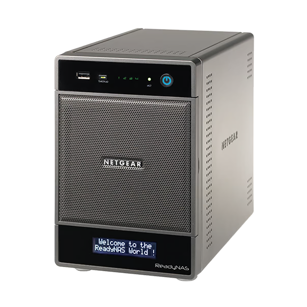
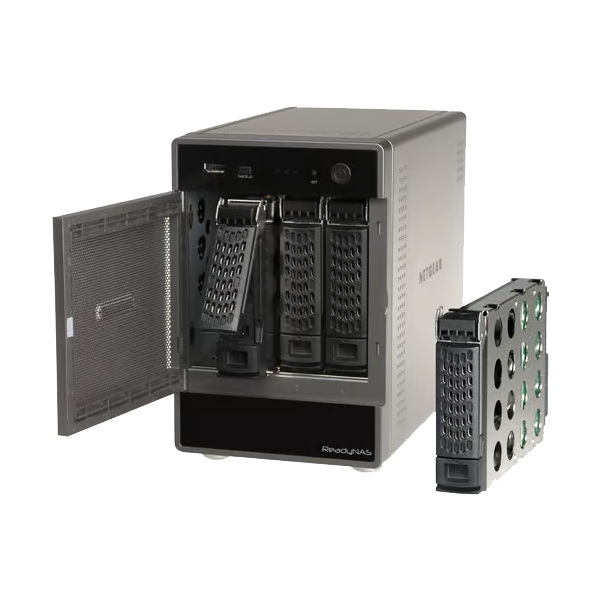

# Documentation du NETGEAR ReadyNAS Ultra 4 (RNDU4200)

  
  

Ce dossier rassemble les outils, firmwares, notes et documents utilisés pour
faire fonctionner un ReadyNAS Ultra 4. La documentation rédigée se trouve dans
[`docs/README.md`](docs/README.md).

> [!CAUTION]
> Le chemin de migration de RAIDiator 4 vers ReadyNAS OS 6 décrit ici est
> historique et non pris en charge officiellement pour ce modèle. Il peut
> réinitialiser le NAS et effacer les disques. Ne l'entreprendre qu'après une
> sauvegarde vérifiée et en acceptant le risque de panne ou de perte de données.

## Accès rapide

- [Parcours de migration vers OS 6.9.6](docs/02-migration-r4-vers-os6.md)
- [Schéma du mode opératoire](docs/migration-mode-operatoire.html)
- [Schéma de l'enchaînement des étapes](docs/migration-enchainement.html)
- [Inventaire commenté des fichiers](docs/01-inventaire.md)
- [RAIDar, SSH et transfert de fichiers](docs/03-acces-et-outils.md)
- [Dépôts Debian Jessie archivés : contexte et précautions](docs/04-debian-jessie.md)
- [Script de permissions : analyse et risques](docs/05-script-permissions.md)
- [Récupération et dépannage](docs/06-recuperation.md)
- [Sources et références](docs/07-sources.md)

## Repères rapides

- Le kit contient un **firmware de transition R4toR6 en 6.9.5**, puis une
  image ReadyNAS OS **6.9.6**. Ce sont deux étapes distinctes.
- Préparer et sauvegarder le NAS avant tout essai. La procédure locale prévoit
  **2 Go de RAM** ; cette valeur est un prérequis de la procédure documentée,
  pas une garantie de compatibilité publiée par NETGEAR.
- NETGEAR indique que les systèmes ReadyNAS et leur logiciel sont en fin de
  vie. Le parcours communautaire R4→R6 est explicitement non pris en charge.
- Les dépôts Debian Jessie ne reçoivent plus de correctifs de sécurité.
  N'utilisez pas les options APT historiques qui désactivent la vérification
  des signatures comme configuration normale.
- Le script `ssh/dirtyfix-readynas-os6-treestructure.sh` ne monte pas de
  lecteur réseau : il modifie en masse propriétaires et permissions.
