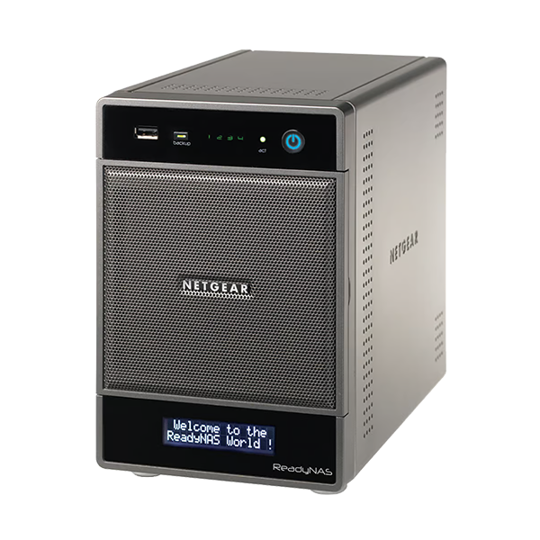
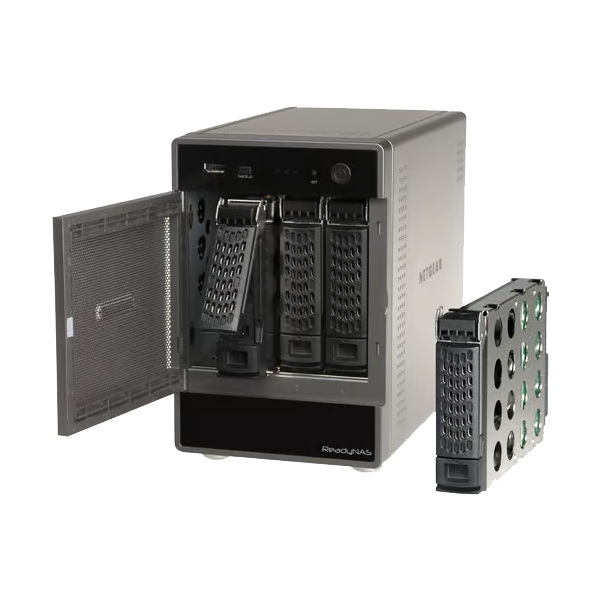
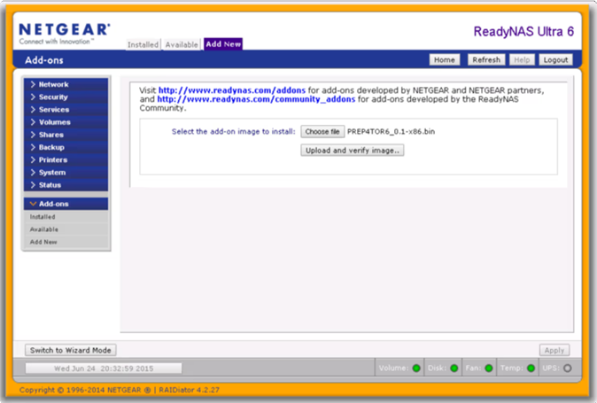

# Inventaire du dossier

  
  

Les archives ZIP doivent être **extraites** avant d'utiliser leur contenu.
Ne téléversez pas directement un ZIP dans l'interface du NAS. Les noms et le
contenu ci-dessous ont été relevés dans le dossier local ; l'inventaire ne
certifie ni l'origine ni l'intégrité cryptographique des binaires.

## `RAIDar/` — découverte et RAIDiator 4

| Fichier | Contenu / usage |
|---|---|
| `RAIDar_Win_4_1_6.zip` | RAIDar Windows 4.1.6, outil ancien de découverte/état ReadyNAS |
| `java-runtime-environment-windows-8u421-27352.zip` | Installateur Java 8u421 pour Windows ; ne l'installer que si RAIDar le demande et après vérification de provenance |
| `RAIDiator-x86-4.2.28.zip` | Image RAIDiator x86 4.2.28 et notes HTML ; firmware historique, pas l'image OS 6 de migration |

NETGEAR publie désormais une version RAIDar plus récente que celle archivée ici
et déclare ReadyNAS en fin de vie. Voir [Sources](07-sources.md).

## `ReadyNasOS6/` — add-on et firmwares

| Fichier | Contenu extrait | Rôle |
|---|---|---|
| `01_R4toR6_Prep_Addon.zip` | `R4toR6_Prep_Addon.bin` | Add-on de préparation installé depuis RAIDiator 4 |
| `02_R4toR6_6.9.5.x86.bin.zip` | `R4toR6_6.9.5.bin` | Image de transition prévue par le parcours communautaire RAIDiator 4 → OS 6 |
| `03_ReadyNASOS-6.9.5-x86_64.zip` | `ReadyNASOS-6.9.5-x86_64.img` et notes de version | Image OS 6.9.5 standard ; ne pas la confondre avec l'image de transition |
| `04_ReadyNASOS-6.9.6-x86_64.zip` | `ReadyNASOS-6.9.6-x86_64.img` et notes de version | Image x86_64 OS 6.9.6, cible finale de la procédure documentée |
| `SHELL-MOD_shellinabox_1.0.0_amd64.deb.zip` | `shellinabox_1.0.0_amd64.deb` | Paquet Debian pour un terminal Web ; paquet ancien, à n'installer qu'en connaissance des risques |
| `READYNAS_OS_6_SM_EN.pdf` | Manuel logiciel ReadyNAS OS 6, anglais | Référence pour l'interface et l'administration OS 6 |
| `ReadyNAS_OS6.2_Desktop_IG06_FR_23Oct2014.pdf` | Guide d'installation de bureau OS 6, français | Guide de première installation, version OS 6.2 |

Les numéros de versions contenus dans les noms sont importants : la procédure
commence par le **BIN R4toR6 6.9.5**, et termine par l'image **OS 6.9.6**.

## `R4toOS6/` — procédure et preuves visuelles

- `Procedure_Migration_ReadyNAS_OS6_6.9.6.docx` et
  `ProcedureMigrationReadyNASOS66.9.6.pdf` : guide local illustré de migration.
- `Upgrading a legacy ReadyNAS from RAIDiator 4.2.x to 6.x _ Blah, Cloud.docx`
  et son PDF : copie d'un article communautaire publié en 2015. Cet article
  précise que le chemin n'est pas pris en charge et qu'il réinitialise le NAS.
- `MAJ JACKSON OS6.txt` : notes locales sur le matériel et le menu de démarrage.
  Elles contiennent aussi des instructions de réinstallation pour d'autres
  générations ReadyNAS ; ne pas appliquer ces instructions au RNDU4200 sans
  confirmation du bon modèle.
- `Image1.png` à `Image5.png` : captures de l'interface historique. Elles
  illustrent l'installation de l'add-on, la mise à jour et un redémarrage ;
  elles ne prouvent pas à elles seules que chaque version fonctionne sur tout
  RNDU4200.

## `ssh/` — accès et administration

| Fichier | Usage |
|---|---|
| `putty-64bit-0.83-installer.msi.zip` | Installateur PuTTY pour une session SSH depuis Windows |
| `WinSCP-6.5-Setup.exe.zip` | Installateur WinSCP pour transferts SFTP/SCP |
| `UpdDebianRepo.txt` | Notes historiques de modification des dépôts APT ; options risquées, voir [Debian Jessie](04-debian-jessie.md) |
| `dirtyfix-readynas-os6-treestructure.sh` | Très long script de changements récursifs/explicites de propriétaires et modes ; ne le lancer pas sans audit et sauvegarde, voir [Permissions](05-script-permissions.md) |

## Précautions sur les fichiers téléchargés

1. Conserver une copie intacte des archives originales.
2. Vérifier la signature numérique de chaque installateur lorsque l'éditeur en
   publie une. Un hash calculé localement sert à repérer une modification
   ultérieure, mais ne prouve pas l'authenticité sans valeur de référence fiable.
3. N'installer aucun utilitaire obsolète sur un poste sensible ou exposé.
4. Les images de firmware sont des exécutables système : ne les flasher que
   sur le modèle/chemin prévus et après comparaison avec une source connue.
