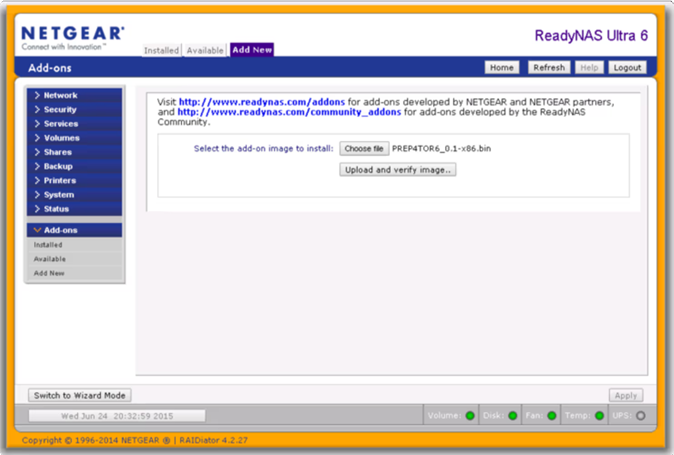
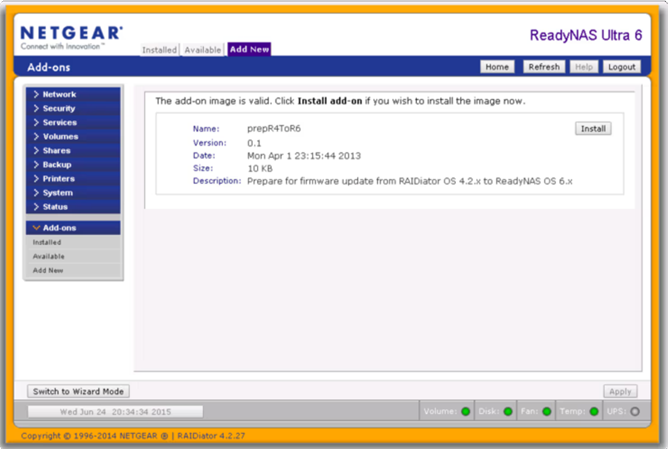
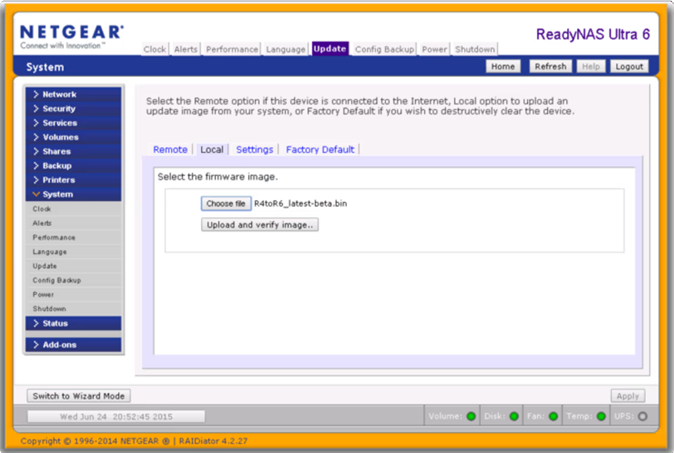
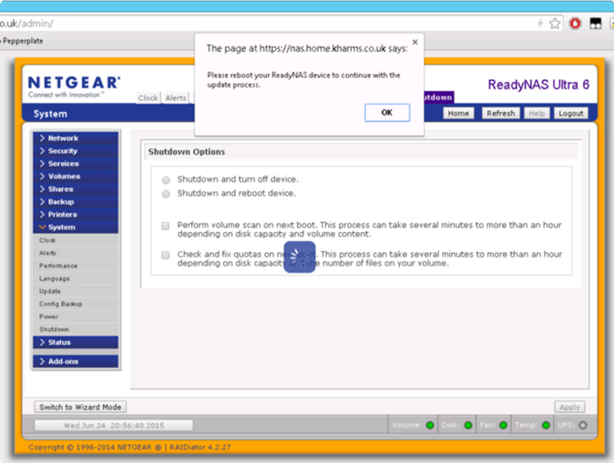

# Migration du RNDU4200 de RAIDiator 4 vers OS 6.9.6

> [!CAUTION]
> **Cette migration est non officielle, risquée et destructive.** Les notes
> locales et l'article communautaire indiquent une réinitialisation usine. La
> procédure locale précise que les partitions et données des disques peuvent
> être effacées. Considérez tous les disques comme perdus jusqu'à restauration
> depuis une sauvegarde indépendante, vérifiée et lisible. RAID et RAIDar ne
> remplacent pas une sauvegarde.

## Statut et limites

Le parcours R4→R6 décrit ici vient d'une procédure communautaire historique
(2015) et de notes locales pour un ReadyNAS Ultra 4. Le dépôt GitHub de
l'add-on indique explicitement que ni l'auteur ni NETGEAR ne prennent en charge
ces fichiers ou le parcours. NETGEAR déclare aujourd'hui ReadyNAS en fin de
vie. Ainsi, OS 6.9.6 est **la cible de cette procédure locale**, pas une
déclaration de compatibilité ou de support constructeur pour le RNDU4200.

Prévoir 2 Go de RAM avant l'essai : c'est le prérequis retenu dans les notes
locales pour cette migration. L'article communautaire historique ne garantit
pas cette configuration et la documentation locale varie entre DDR2 667 et
800 MHz. Vérifier la référence exacte du module installé et la stabilité de la
mémoire ; ne pas déduire une capacité maximale officielle de cette note.

## Avant de commencer

- [ ] Identifier le modèle sur l'étiquette : ReadyNAS Ultra 4 / RNDU4200.
- [ ] Confirmer que le système actuel est RAIDiator 4.x et que le NAS démarre
  sans erreur matérielle.
- [ ] Tester l'état SMART des quatre disques, noter leur ordre et relever les
  alertes. Ne pas lancer la migration sur un NAS instable.
- [ ] Sauvegarder tous les partages vers un autre appareil. Ouvrir quelques
  fichiers restaurés pour vérifier la sauvegarde.
- [ ] Sauvegarder séparément la configuration et le fichier VPD s'ils sont
  disponibles. Garder les mots de passe et paramètres réseau hors du NAS.
- [ ] Disposer d'une alimentation stable, idéalement protégée par un onduleur,
  d'un accès au réseau local et du temps nécessaire pour attendre les
  redémarrages.
- [ ] Télécharger et extraire les archives ; conserver les ZIP originaux.
  Vérifier noms et tailles, et utiliser les images uniquement si leur
  provenance est digne de confiance.
- [ ] Prévoir un moyen d'identifier l'adresse DHCP après le redémarrage
  (tableau du routeur ou RAIDar).

Si une de ces conditions manque, arrêter ici. Le retour arrière peut exiger une
réinstallation et une restauration complète des données.

## Fichiers exacts et ordre

1. Depuis `ReadyNasOS6/01_R4toR6_Prep_Addon.zip`, extraire
   `R4toR6_Prep_Addon.bin`.
2. Depuis `ReadyNasOS6/02_R4toR6_6.9.5.x86.bin.zip`, extraire
   `R4toR6_6.9.5.bin` — c'est l'image de transition du guide communautaire.
3. Depuis `ReadyNasOS6/04_ReadyNASOS-6.9.6-x86_64.zip`, extraire
   `ReadyNASOS-6.9.6-x86_64.img` — c'est l'image finale.

Ne pas substituer l'image standard `03_ReadyNASOS-6.9.5-x86_64.zip` au BIN de
transition. Ne pas téléverser les ZIP eux-mêmes.

## Étapes documentées

Les libellés de menu peuvent différer selon la version/langue de l'interface.
Ne valider une action que si le NAS et le fichier affichés correspondent à
l'étape en cours.

### 1. Installer l'add-on de préparation sous RAIDiator

1. Se connecter à l'interface d'administration RAIDiator.
2. Ouvrir `Add-ons > Add New`.
3. Sélectionner `R4toR6_Prep_Addon.bin`, envoyer et vérifier l'image.
4. Vérifier la description `Prepare for firmware update from RAIDiator OS
   4.2.x to ReadyNAS OS 6.x`, puis installer l'add-on.

### 2. Charger l'image de transition 6.9.5

1. Dans RAIDiator, ouvrir `System > Update > Local`.
2. Choisir `R4toR6_6.9.5.bin`, envoyer et vérifier l'image.
3. Lancer `Perform System Update`, confirmer l'opération et redémarrer
   uniquement à la demande de l'interface.

### 3. Premier démarrage sous OS 6

Ne pas couper l'alimentation pendant le flash ou le premier démarrage. La
procédure locale indique un délai indicatif de 10 à 15 minutes pour le
formatage/réinitialisation ; ce délai n'est pas une garantie. Attendre que le
NAS réapparaisse sur le réseau et que les voyants/RAIDar indiquent un état
stable. Rechercher la nouvelle adresse IP attribuée par DHCP.

L'article communautaire indique qu'après le reset le NAS obtient une adresse
DHCP et que l'identifiant initial est `admin` / `password`. Traiter ces
identifiants comme des valeurs historiques de cette procédure, pas comme une
garantie : suivre l'écran d'initialisation du NAS. Définir immédiatement un
mot de passe administrateur unique et fort.

### 4. Passer de 6.9.5 à 6.9.6

Une fois l'interface OS 6 accessible et le NAS stable :

1. Vérifier la version affichée. Ne pas supposer que le flash de transition a
   installé 6.9.6 : le BIN est nommé **6.9.5**.
2. Dans l'interface OS 6, ouvrir la page locale de mise à jour du firmware.
3. Sélectionner `ReadyNASOS-6.9.6-x86_64.img`, téléverser et vérifier.
4. Lancer la mise à jour, attendre le redémarrage complet, puis vérifier la
   version **6.9.6**, l'état des volumes et les journaux.
5. Restaurer les données depuis la sauvegarde externe seulement après
   validation du système et des volumes.

La capture [Image1](../R4toOS6/Image1.png) montre un écran OS 6.2.4 lors d'une
configuration historique ; elle n'est pas une preuve de l'état final 6.9.6.

## Après migration

- Désactiver les services non utilisés, notamment accès distant et services
  applicatifs non maintenus.
- N'exposer ni l'interface d'administration, ni SSH, ni le terminal Web sur
  Internet. Restreindre l'administration au réseau local de confiance.
- Réactiver une sauvegarde indépendante et vérifier périodiquement une
  restauration.
- Ne pas installer les mises à jour d'une autre branche ou d'un autre modèle
  sur la seule base d'un nom de fichier similaire. La documentation locale
  recommande de s'arrêter à 6.9.6 ; cette recommandation est locale et non une
  promesse de NETGEAR.

## En cas d'échec

Éviter les essais répétés de firmware et tout reset usine tant que les données
ne sont pas sauvegardées. Noter le dernier écran, les voyants, l'adresse IP et
les messages ; voir [Récupération et dépannage](06-recuperation.md).

