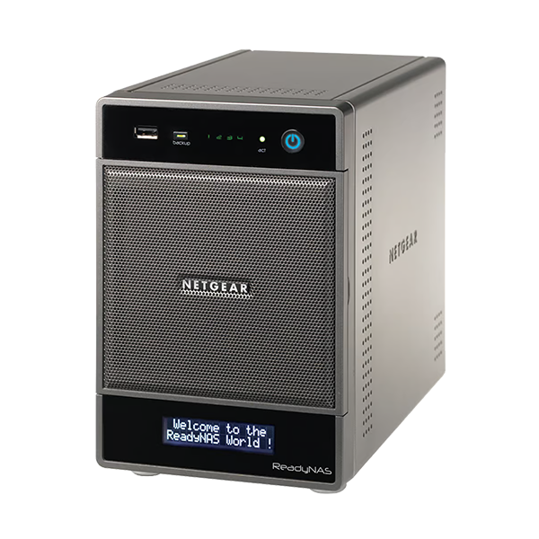
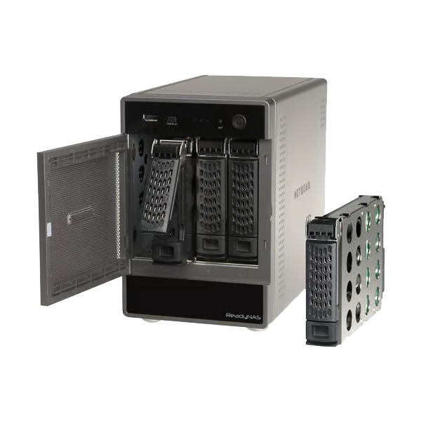

# Découverte et accès au NAS

  
  

## Découvrir l'adresse du ReadyNAS

Le NAS doit être connecté au même réseau local que le poste d'administration.
Consulter d'abord la liste DHCP du routeur. RAIDar peut ensuite aider à
identifier l'appareil, son adresse IP, son état et certaines alertes.

Le dossier contient `RAIDar_Win_4_1_6.zip`, un ancien client. NETGEAR publie
une version RAIDar plus récente dans sa page de téléchargements ; télécharger
les outils uniquement depuis une source de confiance. La découverte locale
ne donne pas à RAIDar le rôle de sauvegarde et ne garantit pas que le NAS est
sain.

L'archive contient également Java 8u421. N'installer Java que si la version de
RAIDar utilisée le requiert, en vérifiant d'abord la signature et la
provenance. Une ancienne version Java ne doit pas être ajoutée à un poste
exposé ou sensible sans nécessité.

## Interface Web d'administration

Ouvrir `https://<adresse-IP-du-NAS>/` ou l'URL de gestion indiquée par
RAIDar/documentation, en tenant compte des alertes de certificat auto-signé.
Ne pas contourner une alerte si l'adresse ou l'identité du NAS ne sont pas
confirmées. Utiliser un mot de passe unique ; ne pas réutiliser les valeurs
par défaut des notes locales.

## SSH avec PuTTY

1. Dans l'interface OS 6, activer SSH uniquement si l'administration en ligne
   de commande est nécessaire.
2. Lancer PuTTY, saisir l'adresse IP locale du NAS et sélectionner SSH.
3. Se connecter avec un compte autorisé, généralement `admin`, puis utiliser
   les droits privilégiés prévus par le système si nécessaire.
4. Désactiver SSH après intervention s'il n'est pas requis en permanence.

Le système sous-jacent est Linux/Debian, mais ReadyNAS OS ajoute ses propres
outils et gestionnaires. Une commande Debian générique peut perturber le
micrologiciel ou être écrasée par une mise à jour. Ne modifier aucun fichier
système sans sauvegarde et procédure de retour arrière.

Le ZIP `putty-64bit-0.83-installer.msi.zip` contient un installateur Windows.
L'archive ne prouve pas sa signature ; vérifier l'éditeur et la signature
numérique avant installation.

## Transfert avec WinSCP

WinSCP peut transférer des fichiers via SFTP/SCP lorsque le service SSH est
activé. Choisir le protocole SSH, l'adresse IP locale et le compte autorisé.
Pour les partages habituels, préférer SMB depuis l'Explorateur Windows plutôt
que de modifier les fichiers système via SFTP.

`WinSCP-6.5-Setup.exe.zip` est un installateur Windows archivé dans le dossier.
Vérifier sa provenance et sa signature avant de l'exécuter. Ne pas lancer
WinSCP en administrateur Windows sans besoin réel.

## Terminal Web ShellInABox

`SHELL-MOD_shellinabox_1.0.0_amd64.deb.zip` contient un paquet Debian ancien
qui ajoute un accès terminal depuis un navigateur. Un terminal Web élargit la
surface d'attaque : ne l'installer que si nécessaire, sur un LAN de confiance,
avec un mot de passe robuste et sans redirection de port depuis Internet.
Après utilisation, désinstaller/désactiver le module et vérifier qu'aucun
service ou port n'est resté accessible. Le dossier ne contient pas de
documentation permettant de certifier la configuration de ce paquet.

## Partages réseau et arborescence système

Windows peut connecter un lecteur réseau vers un **partage SMB exporté**,
par exemple `\\NAS\NomDuPartage`. Cela n'accorde pas l'accès à toute
l'arborescence du système d'exploitation. Le script `dirtyfix` n'effectue pas
ce montage : il modifie des permissions ; voir
[sa fiche de sécurité](05-script-permissions.md).
