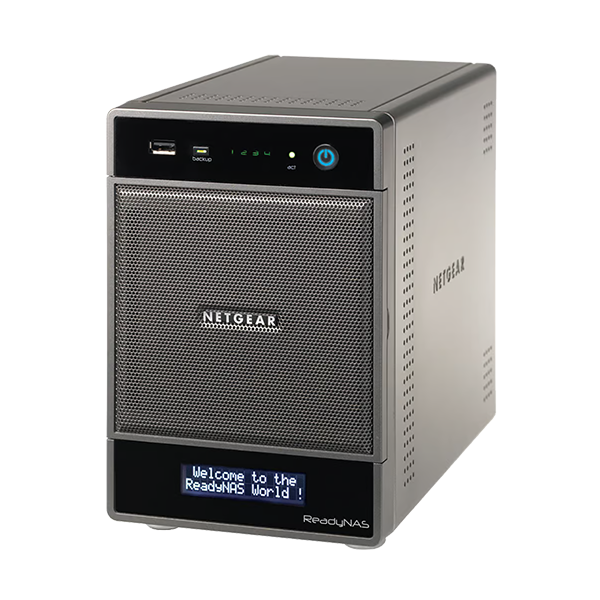
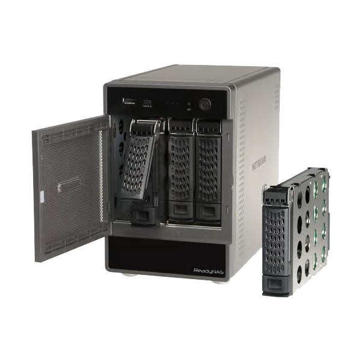

# Récupération et dépannage

  
  

## NAS absent du réseau

1. Vérifier alimentation, câble Ethernet, voyants et lien du commutateur.
2. Consulter les baux DHCP du routeur. Après un reset ou une migration, l'adresse
   peut changer.
3. Utiliser RAIDar sur le même réseau local pour la découverte, puis ouvrir
   l'interface Web avec l'adresse affichée.
4. Vérifier que le poste n'est pas sur un réseau invité ou un VLAN isolé du NAS.

Ne pas commencer par un reset usine. Celui-ci n'est pas un outil de découverte
et peut supprimer les paramètres et données.

## Le NAS ne termine pas le flash

- Ne pas couper l'alimentation pendant l'écriture ou un redémarrage qui semble
  long. Le guide local indique 10–15 minutes pour le premier démarrage, mais
  cela dépend de l'état des disques ; attendre une évolution identifiable.
- Noter exactement l'étape, le fichier envoyé, le message affiché et le
  comportement des voyants.
- Vérifier l'adresse DHCP et les journaux du routeur avant de réessayer.
- Ne pas téléverser plusieurs images au hasard. Le BIN de transition
  `R4toR6_6.9.5.bin` et l'image finale OS 6.9.6 ne sont pas interchangeables.

## Menu de démarrage et bouton arrière

Les notes locales décrivent pour le RNDU4200 un menu de démarrage accessible en
maintenant le bouton arrière lors de la mise sous tension, avec navigation par
le bouton `Backup` en façade et validation par le bouton arrière. Elles ne
donnent pas un guide vérifié des options du menu.

N'utiliser ce menu que si l'option choisie et son effet sont identifiés dans
une documentation applicable précisément au RNDU4200. Certaines options
peuvent réinstaller le système ou réinitialiser les disques. Les descriptions
de reset génériques présentes dans `MAJ JACKSON OS6.txt` mentionnent d'autres
modèles ; ne pas transposer leur séquence de LED ou de bouton au Ultra 4.

## Réinstallation / reset

Un reset usine ou une réinstallation peut entraîner une perte de configuration
ou de données selon le modèle, le menu et l'option sélectionnée. Avant toute
action :

- vérifier une sauvegarde indépendante et lisible ;
- identifier le modèle exact et consulter le manuel correspondant ;
- distinguer réinstallation du firmware, reset de configuration et effacement
  des volumes ;
- ne jamais maintenir un bouton de reset plus longtemps « par précaution » :
  les séquences de boutons peuvent sélectionner une opération différente.

Les mots de passe par défaut des notes locales se contredisent (`password`,
`netgear1`, etc.) et varient selon les générations/versions. Ne pas essayer
une liste de valeurs sur un appareil que l'on ne possède pas ; suivre
l'assistant d'initialisation et définir des identifiants nouveaux.

## Données et volumes

Si un volume est absent, dégradé ou en reconstruction, éviter les changements
de permissions, mises à jour APT et réinitialisations. Ne pas retirer ou
permuter les disques au hasard. Relever les messages d'état et préserver une
copie des disques si les données sont irremplaçables ; demander une expertise
de récupération plutôt que d'écrire sur les disques.
