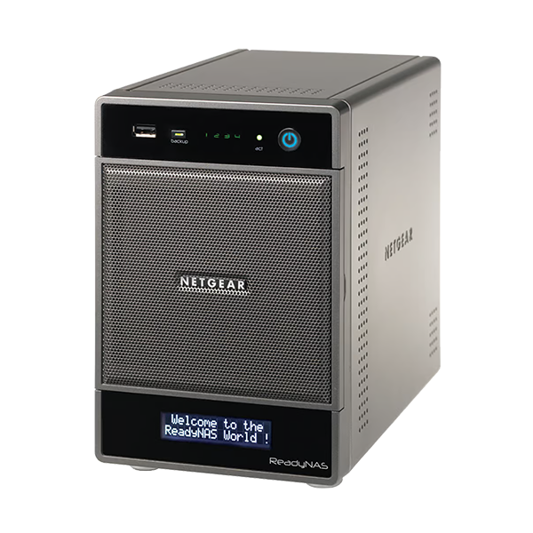
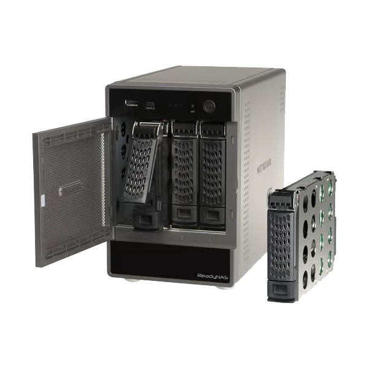

# Sources et références

  
  

Pages consultées le 5 novembre 2026. Les pages de support NETGEAR et les
archives de firmware sont susceptibles de changer. Les procédures locales
restent à valider sur l'appareil précis.

## Constructeur

- [NETGEAR — ReadyNAS Downloads, article 20684](https://kb.netgear.com/20684/ReadyNAS-Downloads)  
  Indique que ReadyNAS et le logiciel ReadyNAS sont en fin de vie, décrit les
  mises à jour locales (images ZIP à extraire), fournit RAIDar et les versions
  historiques RAIDiator 4.2. Cette page ne valide pas le chemin R4→OS 6.
- [NETGEAR — support ReadyNAS OS 6](https://www.netgear.com/support/product/readynas_os_6/)  
  Portail des manuels et ressources OS 6. Le manuel logiciel anglais est aussi
  conservé localement dans `ReadyNasOS6/READYNAS_OS_6_SM_EN.pdf`.
- [NETGEAR — support du RNDU4200](https://www.netgear.com/support/product/rndu4200/)  
  Page de support du modèle ; consulter les documents applicables et les
  avis de fin de vie.
- [NETGEAR — ReadyNAS Downloads, page française](https://kb.netgear.com/fr/30198/T%C3%A9l%C3%A9chargements-ReadyNAS-1479991152715)  
  Informations de téléchargement en français.

## Migration communautaire R4 → R6

- [Myles Gray — Upgrading a legacy ReadyNAS from RAIDiator 4.2.x to 6.x](https://git.blah.cloud/mixtrix/blog/src/branch/master/content/posts/2015-06-25-upgrading-a-legacy-readynas-from-raidiator-4-2-x-to-6-2-x/index.md)  
  Article de 2015. La copie DOCX/PDF correspondante est dans `R4toOS6/`.
  L'auteur indique que l'opération est non prise en charge et réinitialise le
  NAS ; les fichiers locaux suivent un parcours similaire mais visent 6.9.6.
- [Chris Carini — fichiers R4toR6 sur GitHub](https://github.com/ChrisCarini/netgear-readynas-R4toR6)  
  Dépôt communautaire des deux fichiers `.bin`. Il précise explicitement que
  le parcours n'est pris en charge ni par l'auteur ni par NETGEAR.
- [NETGEAR Community — discussion sur OS 6.9.3 et x86 4.2](https://community.netgear.com/t5/ReadyNAS-Storage-Apps-Current/ReadyNAS-OS-6-9-3-Run-on-existing-x86-4-2-notsupported/m-p/905274)  
  Discussion communautaire, pas une déclaration de support.

Les fichiers de cette archive ne sont pas nécessairement identiques aux
fichiers liés par les pages externes. Comparer les noms, vérifier les
signatures/checksums publiés par une source fiable lorsqu'ils existent et ne
pas considérer un hash MD5 comme une preuve cryptographique suffisante.

## Debian

- [Debian — informations sur la version Jessie](https://www.debian.org/releases/jessie/)  
  Debian 8 a été remplacée et le support LTS a pris fin le 30 juin 2020.
- [Debian — archives de distributions anciennes](https://www.debian.org/distrib/archive)  
  Explique où retrouver les versions historiques, dont Jessie.
- [Debian — archive Jessie](https://archive.debian.org/debian/dists/jessie/)  
  Archive de paquets ; disponibilité ne signifie pas maintenance de sécurité.
